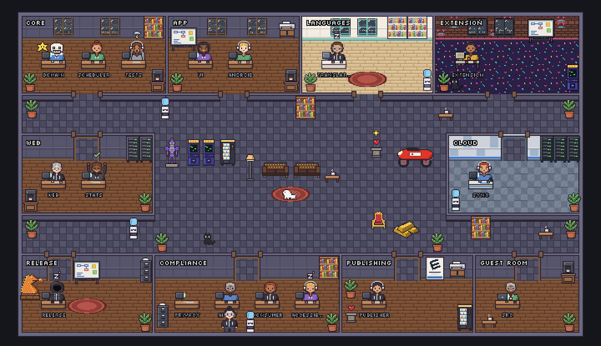
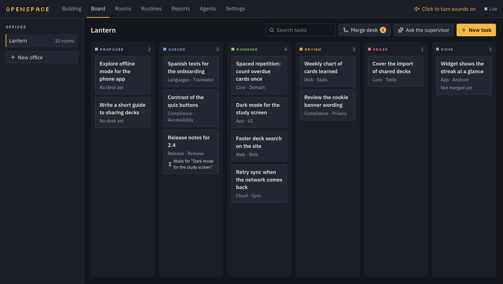
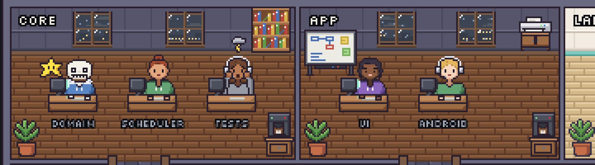

# Openspace

A pixel-art office where AI coding agents work on your projects, and you follow,
review and merge what they do.



Every project is an **office**, every part of it a **room**, every agent sits at
a **desk**. You give a desk a task, or ask the supervisor to split a request into
tasks; agents work on their own copy of the repository, you see what each one is
doing, read its changes, accept or send them back, and merge. Agents run on
[OpenCode](https://opencode.ai) (with any of its models, local ones included) or
on [Claude Code](https://claude.com/claude-code) with your own account.

> Version 0.9.0. It runs on Linux every day; macOS should work. On Windows it runs in
> WSL like on Linux, or natively with a PowerShell script (see [Windows](#windows)).

## What it is for

- **Many agents, one place.** Instead of a terminal per agent, a building where
  you see at a glance who works, who waits for you, who is done and who failed.
- **Your code stays yours.** Each task works in its own git worktree and branch;
  your checkout never moves. Nothing is merged or pushed until you say so.
- **Safe by default.** Roles say what each agent may do alone. Openspace answers
  harmless requests itself and asks you only about risky ones (pushing,
  deploying, touching keys). Folders you mark private are refused to every agent.
- **Less babysitting.** A queue, task dependencies, a review by Claude before
  yours, checks after merging, reserve models when an account runs out, agents
  stopped and restarted when they go in circles.
- **Security audits.** A Security desk in each office reads the code for real
  holes with Cloudflare's security-audit skill, has every finding disproved by a
  fresh helper, and never changes the code: confirmed findings become fix tasks.
- **Routines.** Recurring jobs for your own life: a morning paper, mail sorting,
  job offers, dependency checks, delivered to Telegram and never acting on what
  cannot be undone without your yes.



## What you need

| | What for |
| --- | --- |
| [git](https://git-scm.com) | Openspace works on git repositories |
| [.NET SDK 10](https://dotnet.microsoft.com/download) | The API |
| [Node.js 22](https://nodejs.org) or later | The page, and OpenCode |
| [OpenCode](https://opencode.ai), with a model provider | The agents |
| [Claude Code](https://claude.com/claude-code), signed in (optional) | Desks on Claude, plans and reviews by Claude; it uses your account and its limits, never an API key of Openspace. Without it, OpenCode plans and, with a model chosen for it, reviews |
| [GitHub CLI](https://cli.github.com), signed in (optional) | Pull requests and pushes |
| Firefox and geckodriver (optional) | PDF pages of the routines |
| An NVIDIA card and a llama.cpp server (optional) | Models on your own computer |

## Getting started

```bash
# 1. The tools (once). OpenCode, and optionally Claude Code:
npm install -g opencode-ai
opencode auth login                  # connect a model provider (OpenCode's free models need none)
npm install -g @anthropic-ai/claude-code && claude    # optional: sign in once

# 2. Openspace
git clone https://github.com/RichSenes/Openspace.git
cd Openspace

# 3. Start OpenCode, the API and the page, each in the background
scripts/openspace start
```

Then open <http://localhost:5173>. The first start builds the API and installs the
page's packages, which takes a minute; the database is created on its own.

### Windows

The simplest way is WSL (`wsl --install`, then the steps above inside Ubuntu, with
your repositories inside WSL too): everything works as on Linux and the page opens in
the Windows browser. Natively, install the same tools for Windows, then in
PowerShell:

```powershell
git clone https://github.com/RichSenes/Openspace.git
cd Openspace
scripts\openspace.ps1 start      # also stop, restart api, status, logs api
```

If PowerShell refuses scripts, run it as
`powershell -ExecutionPolicy Bypass -File scripts\openspace.ps1 start`. Logs live in
`%LOCALAPPDATA%\openspace\logs`. Native Windows is newer and less tried than Linux:
permissions in auto mode read Windows paths (drive letters, either slash, any case),
room checks run with `cmd.exe`, and local models on the graphics card are for Linux
only.

### With a company subscription

Openspace only uses the models OpenCode knows, so what your company allows decides
everything:

- **GitHub Copilot**: `opencode auth login`, choose GitHub Copilot and sign in with
  your work account; its models appear as `github-copilot/...` for desks, plans and
  reviews. Your organisation's Copilot policy must allow them.
- **A company model** (an OpenAI-compatible endpoint): add it as a provider in
  OpenCode's configuration, with its key in an environment variable, and give it a
  `limit.context` so Openspace knows how big its conversation can be.
- **Without Claude Code**, choose in Settings → Supervisor and reviewer the OpenCode
  model that plans and the one that reviews finished work before you.
- Keep Openspace's own outside calls off if you want none: `Releases:Enabled=false`,
  and no town for the weather.

### Your first office

1. **New office** in the sidebar, with the name of your project.
2. In **Rooms**, set the office's repository: the folder of a git repository on
   your computer (Openspace can initialise one).
3. Open a room for a part of the project ("Web", "API"), write what it is about
   in its context, and add a desk: a name, the OpenCode agent (`build` is
   OpenCode's own) and a model, or Claude Code.
4. Optionally, in **Agents**, define a role (what the agent is, its rules, what it
   may do without asking) and give it to the desk.
5. In **Board**, **New task** for the desk, or **Ask the supervisor** to split a
   request into tasks, then approve them.
6. Watch it in **Building**. When the task is in review, open it on the board:
   read the diff and the agent's summary, then **Accept** or **Send back** with a
   note. Accepted work goes into your branch with **Merge** (one task, or all of
   them at the Merge desk).



### Every day

```bash
scripts/openspace status           # what is running
scripts/openspace logs api         # follow a log (api, web or opencode)
scripts/openspace restart api      # after changing the code: rebuild and restart the API
scripts/openspace stop
scripts/openspace restore FILE     # put a database backup back
scripts/openspace kanji-data       # once, only for the morning paper's kanji of the day
```

Logs and process ids live in `~/.local/state/openspace`. Ports change with
`OPENSPACE_API_PORT` (5145), `OPENSPACE_WEB_PORT` (5173) and
`OPENSPACE_OPENCODE_PORT` (4096). Settings you change in the page are kept in
`openspace.settings.json` next to the API; everything else is in
[the API's configuration](src/backend/Openspace.Api/README.md#configuration).

### Updates

Openspace never updates itself. Twice a day it looks at the releases published on
GitHub for the repository it was cloned from; when a newer one is out, a banner
says what changed, with "remind me tomorrow". To update:

```bash
git pull
scripts/openspace restart
```

## How it works

1. **A task starts** when a seat is free (`Queue:Seats`, one by default) and its
   desk is idle. Openspace makes a git worktree on an `openspace/...` branch and
   briefs the agent: the room's context and rules, the task, the notes of the
   team, what earlier tasks it builds on did.
2. **While it works**, its steps become speech bubbles, a battery shows how full
   its conversation is, helpers it calls in stand beside it as interns, and it
   walks to the furniture of its room (shelves to read, server racks to run
   commands, the coffee machine on a break). Permissions are answered by
   Openspace or wait for you behind the **needs you** button.
3. **When it stops**, the task goes to review with the agent's summary, the diff,
   the checks you should try by hand and the tokens it spent. A reviewer reads it
   first: Claude Code when it is installed, or an OpenCode model you choose. Rooms can require a procedure whose steps the
   agent reports with evidence before review.
4. **You decide**: accept (committed on the task branch), send back for another
   round, or discard. Accepted work merges into the branch you choose, in a
   throwaway copy when it is not checked out; conflicts go back to the agent.
   Each room's check command runs on the merged branch. Push, or open a pull
   request instead.
5. **Everything is logged**: steps, file changes, commands with their output,
   permissions, notes. Reports of a day or of an epic, and a changelog for the
   people using the product, are written from that log in your language.

More of what it does, in short:

- Rooms drawn by hand or laid out on their own, moods per room, doors, windows
  with your town's real weather, a minimap and a live activity feed.
- Claude Code sessions you start yourself in a terminal show up as guests, in the
  guest room of the office whose repository they work in.
- Usage limits: desks pause while their account is over its limits, or go on
  with the office's reserve models; the board says why each queued task waits.
- Local models are loaded on the graphics card when a desk needs one and give way
  to the programs that come first (an image generator, a trainer).
- Skills (written guides such as `security-audit` or `tdd`, installed in
  `~/.claude/skills`) are handed to every desk, read-only: all of them, or only
  those a role names. OpenCode desks read the same folder.
- Security audits keep their records outside the repository
  (`~/.local/share/openspace/security-audits/<office>/run-N`), so each run builds
  on the last; the Security view lists the runs, the report and the findings.
- Sounds for the moments that matter, a daily database backup, private folders,
  offices kept on this computer only.

## Repository layout

```
docs/                        Vision and plans, art style, sprite format, screenshots
scripts/openspace            Start, stop, restart, logs, restore, kanji data (openspace.ps1 on Windows)
scripts/release              Publish a version
src/backend/
  Openspace.Domain/          The business model, no dependencies
  Openspace.Application/     Use cases, ports, the queue, routines
  Openspace.Infrastructure/  OpenCode, Claude Code, git, SQLite, Google, Telegram, local models
  Openspace.Api/             ASP.NET Core host: HTTP, SignalR, MCP tools for agents
src/frontend/                React + PixiJS: the building and the panels
tests/                       Architecture, domain, application, infrastructure and API tests
tools/                       Helper scripts (pixelgrid.py: pictures to sprites)
```

Each project has its own README:
[Domain](src/backend/Openspace.Domain/README.md) ·
[Application](src/backend/Openspace.Application/README.md) ·
[Infrastructure](src/backend/Openspace.Infrastructure/README.md) ·
[API](src/backend/Openspace.Api/README.md) (endpoints, configuration, routines) ·
[Frontend](src/frontend/README.md) ·
[Tests](tests/README.md).
The plan is in [docs/vision.md](docs/vision.md), the pixel art rules in
[docs/art-style.md](docs/art-style.md).

## Development

```bash
dotnet build && dotnet test                         # backend
cd src/frontend && npm ci && npm run build && npm run lint && npm test   # page

# A second copy next to the one you use, with its own database
ConnectionStrings__Openspace="Data Source=/tmp/try/test.db" Settings__Path=/tmp/try/settings.json \
  Queue__Enabled=false dotnet run --project src/backend/Openspace.Api --urls http://127.0.0.1:5245
OPENSPACE_API=http://127.0.0.1:5245 npx vite --port 5273   # in src/frontend
```

Open the page with `?lab` for the sprite lab: every sprite, pose and animation.

To publish a version, write what changed in a Markdown file, then from a clean
`main`: `scripts/release 0.10.0 notes.md`. It sets the number in
`Directory.Build.props` and the page's `package.json`, commits, tags, pushes and
opens the GitHub release.

### Ground rules

- Code, comments and docs are in English.
- No personal or company data: examples, tests and screenshots use made-up names.
- No keys or secrets in the repository: they come from environment variables or
  files outside it.
- Every change of behaviour comes with tests, and with the README of what it
  touches, in the same commit.
