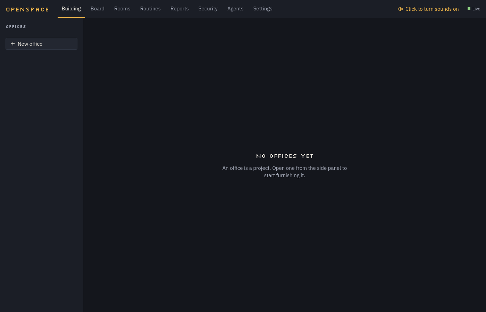

# Usability review

Goal: anyone can install Openspace, set it up and change everything from the interface,
without editing JSON, `appsettings` or files in `~/.config`. This document is the review
done before touching the code: what a new person meets today, what is configured only
by hand, and the proposals in order of priority.

## How the review was done

- A throwaway instance (API on 5245, Vite on 5273, its own database) with every engine
  switched off and every folder (Telegram, Google, skills, audits, backups) pointed to an
  empty scratch folder.
- A made-up office, **Crumb** (the ordering app of a bakery that does not exist), with a
  fake git repository, three rooms, five desks, three roles, tasks in every state,
  four routines with runs and two proposals, a report, and a second empty office.
- Headless Firefox through geckodriver; each view rendered in an iframe of the exact size:
  1920×1080, 1400×900, 1280×800, 1180×820 and 1024×768 (tablet landscape),
  820×1180 and 768×1024 (tablet portrait), 390×844 (phone). 8 views × 8 sizes, plus
  the first run, full-length shots of the long views and the main dialogs.
- Text colours measured against the backgrounds (WCAG 2.2 formula), not judged by eye.

A selection of the shots is in [`screenshots/usability/`](screenshots/usability/).

## Overall feeling

On a laptop or desktop, Openspace is pleasant: the building is charming, the board is
clear, and the texts explain themselves. Two things get in the way of someone new:

1. **It assumes the reader already knows the setup.** The first screen says "No offices
   yet" and nothing about whether OpenCode or Claude Code are installed, reachable or
   signed in; that is only written inside *Agents* and at the bottom of *Settings*. A new
   person can create an office, desks and tasks that will never run, and not know why.
2. **The power is behind the scenes.** Routines keep most of their settings in a JSON box,
   local models live in `appsettings.Local.json`, Telegram channels are names of
   variables in an `.env` file, offices of real projects come from Python scripts. The
   interface shows the result of the configuration, not the configuration.

Below 1100 px the layout does not adapt: the office list keeps 240 px on tablets and sits on
top of every view on phones, the tabs are cut without a hint, the building shrinks to a
stamp and its toolbar spills off the screen.

## Sections and use of space

The way the views are divided, and how they use the width, is a problem of its own, not a
list of small layout bugs.

| | Finding |
|---|---|
| P1 | **Settings** is one column about 720 px wide that leaves half of a 1400 px window empty (two thirds at 1920). Its cards go from permissions to the number of seats, the supervisor, the Claude account, sounds, the weather, the version, backups, Google and keys, in no order a person would guess. |
| P1 | **Rooms** holds the office's settings and every room's settings on the same page. |
| P2 | **Routines** cards stop at about 760 px, with the right half of the page empty, while each card repeats the same paragraph. |
| P2 | **Agents** puts the engine status above the roles, and the role form beside a short list. |
| P2 | **Reports** puts three different actions with their inputs on one row. |

Proposal: one pass on how things are grouped, before changing them one by one.

- Group by what the person wants to do, not by when the feature was added.
- Settings becomes sections with an index on the side (a menu at the top on narrow screens):
  *Engines*, *Local AI*, *Connections* (Google, Telegram), *How agents work* (permissions,
  seats, supervisor and reviewer), *Look and sound* (sounds, weather), *System* (version,
  backups, storage).
- On wide screens, use the width: index and content side by side, two columns where the
  content allows it, and no page made of one narrow column.
- Each view keeps one subject: office settings leave Rooms, engine status leaves Agents.

## Findings by view

Severity: **P1** blocks or misleads a new person · **P2** slows down or breaks one of our
design rules · **P3** polish.

### Everywhere

| | Finding | Rule |
|---|---|---|
| P1 | Nothing in the top bar says that something waits for you except live permission requests. Two tasks to approve, one in review, one failed and two routine proposals: the top bar is empty. Proposals are only visible inside *Routines*, reviews only on the *Board*. | — |
| P1 | No setup check. Engines that are missing or unreachable are mentioned only in *Agents* and at the end of *Settings*. | affordance |
| P2 | Tabs are cut at 820 px and below ("Agen", "Se", "Routin") with no scroll hint and the wordmark disappears; on a phone half the views are unreachable without guessing to swipe. | responsive |
| P2 | On phones the office list (≈240 px high) is on top of every view, so the content starts at a third of the screen. | responsive |
| P2 | On tablets the sidebar keeps a fixed 240 px (30% of an 820 px screen). | responsive |
| P2 | Input and select borders (`--line` #333948) are 1.4:1 on the panels: WCAG 1.4.11 asks 3:1 for the edges of fields. Text colours all pass AA (mute 6.3–7.6:1, ink 12–15:1, states 5.6–10:1). | WCAG AA |
| P2 | "Click to turn sounds on" is in the accent colour on every page: the loudest thing on screen is the least important. | no random decorations |
| P3 | Date formats mix: `11/11/2026`, `Nov 11, 2026, 11:31 PM`, `yesterday at 23:31`, `07:30 AM` in the time field. | — |
| P3 | Interface in English, report language default "Italiano": there is no interface language choice and no explanation of which language what is written in. | — |

### Building

| | Finding |
|---|---|
| P2 | Below 1100 px the hint "Scroll to zoom · drag to move…" wraps one word per line and the toolbar (Fit, Arrange, Lights off, Hide map, mood) runs off the right edge; the mood select is cut. |
| P2 | On tablet and phone the plan opens tiny in the middle of a tall empty area. |
| P2 | The activity line reads "No desk: Task created": unclear wording for a task without a desk. |
| P3 | Desk names in the Routine room are cut ("BAKER JO…", "WEEKLY C…") with no full name on hover. |
| P3 | The room count "4 rooms" in the sidebar counts the Routine room the person never opened. |

### Board

| | Finding |
|---|---|
| P2 | On narrower windows (or with the task panel open) the actions (Search, Merge desk, Ask the supervisor, New task) wrap into two rows, and on phones into a vertical stack with the office name floating on the left. |
| P2 | Columns scroll sideways: on tablet and phone *Review* and *Failed*, the columns that need you, are off screen, and with the task panel open at 1400 px *Failed* and *Done* disappear. |
| P2 | A task created without a desk goes to *Proposed*, not where it was asked: the reason is not shown on the card. |
| P3 | Column headers in the pixel font at 9–10 px are the hardest text to read on the page. |

### Rooms

The longest page (≈2900 px at 1400 wide) and the one that mixes the most.

| | Finding |
|---|---|
| P1 | Office settings (repository, keep local, private folders, reserve models) are at the top of *Rooms*: they are not about rooms and a new person does not look for them there. |
| P2 | Eight separate *Save* buttons (3 for the office, 3 per room: context, procedure, check) plus *Add desk*. Easy to edit two boxes and save one. |
| P2 | The Routine room shows mood, context, procedure and check, which do not apply to it. |
| P2 | Desk form selects are cut ("OpenCode: the moc…", "The role's, or the ag…"). |
| P2 | Agent names accept only lowercase letters, digits and dashes; the field does not say so, the error comes only after saving. |
| P3 | Reserve models are free text ("one per line, at most 4"): a list to pick from would avoid typos. |

### Routines

| | Finding |
|---|---|
| P1 | *Change* edits name, days and time; everything else (15 keys for the morning paper and the job offers, 12 for mail…) is in "Advanced settings (JSON)". Sources, sections, channel, model, folders: only by typing JSON. |
| P2 | `channel` is the name of a variable in `telegram.env` (e.g. `KAWARABAN`): nothing in the page lists the channels or tests one. |
| P2 | Proposals are well made (clear title, facts, link, *Yes, go ahead* / *No*) but live only here, with no count on the tab. |
| P3 | "Before it touches your things" repeats the same paragraph on every card; one line under the choice would do. |

### Reports

| | Finding |
|---|---|
| P2 | Three different actions on one row (day report, epic report, changelog) with their inputs mixed; on narrow screens they stack without grouping. |
| P3 | The language select is the first thing on the page but applies to all three. |

### Security

Clean empty state with one button that names the action. **P3**: the explanation names
Cloudflare's skill and Claude Code (sonnet) before saying what the person gets.

### Agents

| | Finding |
|---|---|
| P1 | There are no ready-made roles. A beginner starts from an empty form and has to write the instructions and choose the permissions alone. A set of roles to add with one click (backend developer, frontend developer, database, tester, writer, reviewer…), each with sensible instructions and permissions, would get a first office working in minutes. |
| P2 | The tab is called *Agents* but holds roles; the engine status box at the top is the only place that says the engines are missing. |
| P2 | A new role starts with *Change files*, *Run commands* and *Use the web* all on *Allowed*: the safest default would be *Ask* for commands. |

### Settings

| | Finding |
|---|---|
| P2 | One long page (≈2300 px) with no index. |
| P2 | *Save settings* saves only the first three cards; the other cards save on their own. Two behaviours on one page. |
| P2 | The first radio button is drawn above its label, the second beside it. |
| P2 | Claude Code options stay checked (and greyed) when Claude Code is not installed: it is not clear whether they do anything. |
| P2 | Google: "first put your OAuth client in `<path>`" — no guided procedure, no button to choose the file. |
| P3 | The *Show its weather* button is taller than its field. |

### First run

The empty state says "Open one from the side panel" while the button is called *New office*.
There is no path: install engines → open an office → point it at a repository → add a desk
→ first task.

## What is configured only by hand

| What | Where today | How it should look |
|---|---|---|
| OpenCode address, events, tools URL | `appsettings*.json` (`OpenCode`) | *Settings › Engines*: address with **Test**, status always visible |
| Claude Code command, context window, timeouts | `appsettings*.json` (`ClaudeCode`) | same page, advanced section |
| Local models (command, arguments, memory, context), GPU holders, decider, idle/yield times | `appsettings.Local.json` (`LocalModels`) | *Settings › Local AI*: list of models with **Add**, **Start**, **Test**, memory used; holders as a list of programs |
| Telegram bots and group | `~/.config/openspace/telegram.env` + `telegram.json` | *Settings › Telegram*: add a bot (token), find the group, pick topics, **Send a test**; routines pick a channel from a list |
| Google OAuth client | file copied by hand to `~/.config/openspace/google-client.json` | guided steps with links, **Choose file**, then *Connect* |
| Routine settings (per kind: cv 10 keys, followup 9, job-offers 15, mail 12, maintenance 9, morning-paper 15, newsletters 10, weekly 6) | JSON box | a form per kind with the explanation under each field; JSON stays as *Advanced* |
| Kanji dictionaries | `scripts/openspace kanji-data` | a **Download** button in the morning paper form when kanji are on |
| Offices of real projects (rooms, desks, roles, plan, furniture) | Python scripts outside the repo | **office templates**: pick "web app", "mobile app", "library"… then adjust; export/import an office |
| Skills folders, plugin folder | `appsettings` (`Skills`) | *Settings › Skills*: folders with the list of what was found |
| Workspaces root, backups folder and copies kept | `appsettings` | *Settings › Storage* |
| Release checks, GitHub command | `appsettings` | *Settings › Version* (exists) gains the on/off |
| Operator name | `appsettings` (`Operator`) | *Settings › You*: name, language, time format |
| Guests (Claude sessions folder, stay time) | `appsettings` (`Guests`) | on/off in *Settings* |

## Principles for the changes

1. Every setting is a field with its explanation **under** it; JSON only as *Advanced*.
2. Every external link (engine, local model, Telegram, Google) has a guided procedure that
   ends with a **Test** button and a clear result.
3. What waits for the person is counted in one place in the top bar, whatever view made it.
4. One save per form, or saving on change: never both on one page.
5. Ready-made starting points: roles, routine presets and office templates.
6. Below 1100 px the layout changes, it does not just shrink.
7. Views are grouped by what the person wants to do, and wide screens use their width.

## Proposals in order

1. **Routine forms, starting from the morning paper**, reviewed together as the first case
   of the style and sources editor; then **job offers**. *(P1, agreed plan)*
2. **"Needs you" inbox in the top bar**: permissions, questions, reviews, failures, proposed
   tasks and routine proposals, with a count and a link to each. *(P1)*
3. **Setup check and first-run path**: engine status in the top bar when something is
   missing, and an empty state that walks through the first office. With it, **ready-made
   roles** in Agents (backend developer, frontend developer, database, tester, writer,
   reviewer…) that a beginner adds with one click. *(P1)*
4. **Office settings out of Rooms**: an *Office* page (repository, local only, private
   folders, reserves) and one save per room. *(P1/P2)*
5. **Sections and space**: Settings split into sections with an index, wide screens used
   in full, one subject per view (see *Sections and use of space*). *(P1)*
6. **Settings › Local AI**: models, start/stop, test, GPU holders. *(P1 for anyone without the
   config file)*
7. **Guided Telegram and Google**, with channels chosen from a list in routines. *(P2)*
8. **Responsive pass** below 1100 px: collapsible office list, scrollable tabs with a
   *More* menu, board with the columns that need you first, building toolbar that wraps.
   *(P2)*
9. **Office templates** and export/import. *(P2)*
10. Small fixes: field borders to 3:1, radio alignment, cut selects, agent-name hint,
   sound prompt in a quiet colour, one date format, safer role defaults. *(P2/P3)*

## Not covered

The simulation had no engine running: live states (agents typing, interns, energy, walks,
permission requests) and the diff of a real task were not seen. They were reviewed in
earlier rounds and are not the subject of this one.
